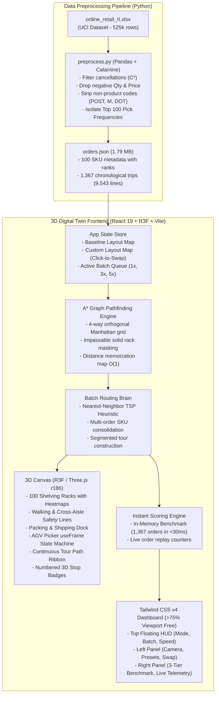

# NEXAI Warehouse Digital Twin
> **Hackathon Problem Statement 4.2**: Browser-Based 3D Digital Twin for Warehouse Picking Optimization & Layout Simulation

[](https://react.dev/)
[](https://threejs.org/)
[](https://docs.pmnd.rs/react-three-fiber/)
[](https://tailwindcss.com/)
[](https://python.org/)
[](https://pandas.pydata.org/)
[](https://deepmind.google/)
[](https://creativecommons.org/licenses/by/4.0/)

---

## Submission Links
- **GitHub Repository**: [https://github.com/Suthish-S-lone/warehouse-twin](https://github.com/Suthish-S-lone/warehouse-twin)
- **Live Interactive 3D Web App**: [https://warehouse-twin.vercel.app](https://warehouse-twin.vercel.app) *(Deployment Link Placeholder)*
- **5-Minute Video Demonstration**: [https://youtu.be/warehouse-twin-demo](https://youtu.be/warehouse-twin-demo) *(Demo Video Placeholder)*
- **Detailed Engineering Log**: [DEV_LOG.md](./DEV_LOG.md)

---

## 1. Problem Statement & Solution Overview

### Problem Statement 4.2: Warehouse Digital Twin (3D Picking Floor Game)
In e-commerce distribution centers, order picking represents over **55% of all warehouse operating expenses**, with travel time between storage locations accounting for up to **70% of a picker's working shift**. Suboptimal SKU slotting causes severe walking overhead, bottlenecks, and delayed order fulfillment.

**Problem Statement 4.2** tasks teams with transforming real-world transactional data into an interactive, browser-based **3D Warehouse Digital Twin Game** where players optimize inventory placement to minimize cumulative picker travel distance and order fulfillment time.

### Our Solution
**NEXAI Warehouse Digital Twin** is an end-to-end digital twin and layout simulation platform:
1. **High-Performance Data Ingestion Pipeline (`preprocess.py`)**: Ingests the 525,461-row UCI Online Retail II dataset, removes cancellations and non-product entries, isolates the top 100 high-velocity SKUs, and exports a chronological stream of 1,367 real picking trips into a lightweight `orders.json` payload.
2. **Interactive 3D Picking Floor (React Three Fiber & Drei)**: Generates a 100-rack grid warehouse with designated walking aisles, a central packing dock, dynamic SKU pick velocity heatmaps, and a stylized animated AGV picker.
3. **Strict A\* Grid Pathfinding Engine**: Enforces 4-way orthogonal aisle navigation where storage racks act as impassable solid obstacles, guaranteeing zero diagonal shortcuts or rack-clipping.
4. **Interactive Slotting Game Mode**: Features 3D Click-to-Swap slot mechanics and one-click presets (**Optimal Baseline**, **Chaotic Random**, **Worst-Case Inverted**) to allow players to experiment with layout configurations.
5. **Backend Brain: Batch Picking with Nearest-Neighbor TSP**: A multi-order batching engine grouping 3 to 5 sequential orders per trip and optimizing the multi-stop picking tour via Nearest-Neighbor Traveling Salesperson Problem (TSP) heuristics.
6. **Instant Full-Month In-Memory Benchmark**: An instant scoring engine that evaluates all 1,367 orders (9,543 order lines) in $<30\text{ ms}$ upon slot swap, providing instantaneous empirical proof of labor savings.

---

## 2. Architecture & Technology Stack

### System Architecture Diagram



### Technology Stack & Starters
- **Frontend Framework**: React 19.3, Vite 8.3 (React starter template)
- **3D Graphics & WebGL**: Three.js (0.186.1), `@react-three/fiber` (9.8.2), `@react-three/drei` (10.7.9)
- **Styling**: Tailwind CSS v4 (`@tailwindcss/vite`, `@import "tailwindcss";`)
- **Data Engineering**: Python 3.12, Pandas 2.x, `python-calamine` (Rust-accelerated Excel parser), OpenPyXL
- **AI Pair Programming Assistant**: Google Antigravity (Advanced Agentic Coding)

---

## 3. Warehouse Layout Specifications (Mandatory PS 4.2 Requirement)

The procedural 3D warehouse floor is configured in [`App.jsx`](file:///c:/nexai-warehouse-twin/3d-frontend/src/App.jsx) according to these warehouse logistics parameters:

| Parameter | Value | Description / Coordinates |
| :--- | :--- | :--- |
| **Total Rack Slots** | **100 slots** | 5 double-row bays $\times$ 2 back-to-back columns $\times$ 10 vertical rack slots |
| **Grid Dimensions** | **$22 \times 16$ cells** | $X \in [0..21]$, $Y \in [0..15]$ (Visual Scale Multiplier: `CELL_SIZE = 2.2 m`) |
| **Floor Footprint** | **$48.4\text{ m} \times 35.2\text{ m}$** | Total floor surface area: **$1,703.68\text{ m}^2$** spacious architectural layout |
| **Storage Rack Locations** | **10 Columns** | $X \in \{2, 3, 6, 7, 10, 11, 14, 15, 18, 19\}$ spanning $Y \in [3..12]$ |
| **Vertical Pick Aisles** | **10 Aisles ($2.2\text{ m}$ wide)** | Left pick aisles: $X \in \{1, 5, 9, 13, 17\}$; Right pick aisles: $X \in \{4, 8, 12, 16, 20\}$ |
| **Cross-Aisles** | **2 Aisles ($2.2\text{ m}$ wide)** | Front cross-aisle at $Y = 2$; Back cross-aisle at $Y = 13$ (safety guide lines) |
| **Perimeter Boundary Aisles** | **4 Aisles** | Boundary navigation lanes at $X = 0, 21$ and $Y = 0, 14, 15$ |
| **Packing Dock Coordinates** | **$(X = 10, Y = 1)$** | Front center origin node adjoining front cross-aisle with supervisory platform |
| **Multi-Picker Fleet** | **1 to 3 Pickers** | Articulated human workers (Emerald/Cyan/Amber vests) pushing AGV carts |
| **Aisle Congestion Engine** | **$1.25\text{ cell}$ proximity** | Yielding state machine, flashing amber beacon, live delay telemetry |
| **Picker Walking Speed ($v_{\text{walk}}$)** | **$1.2\text{ m/s}$** | Standard human warehouse picker walking velocity used for scoring |
| **AGV Animation Speed** | **$3.6\text{ m/s}$ base** | Multiplied by user playback speed ($1\times, 5\times, 10\times, 25\times$) |
| **Pick Handling Time ($t_{\text{pick}}$)** | **$4.0\text{ s}$ per item** | Standard handling time to scan and pick an item from a rack shelf |

---

## 4. Evaluation Metrics & Full-Month Benchmark Table

All benchmark figures were computed across the complete December 2009 historical dataset (**1,367 orders / 9,543 pick lines**):

| Layout & Dispatch Configuration | Total Walking Distance | Total Labor Time | Avg Pick Time / Order | Distance vs. Chaotic | Distance vs. Baseline | Labor Hours Saved vs. Baseline |
| :--- | :---: | :---: | :---: | :---: | :---: | :---: |
| **Inverted / Worst-Case (1x Single Pick)** | 239.78 km (239,776 m) | 66.11 hrs | 174.1 s | $+4.6\%$ | $+18.3\%$ | $-8.58$ hrs (Loss) |
| **Chaotic / Random Layout (1x Single Pick)** | 229.17 km (229,174 m) | 63.65 hrs | 167.6 s | Baseline (0%) | $+13.0\%$ | $-6.12$ hrs (Loss) |
| **Golden-Zone Baseline (1x Single Pick)** | **202.72 km (202,717 m)** | **57.53 hrs** | **151.5 s** | **$-11.5\%$** | Reference (0%) | Baseline Ref |
| **Baseline + Batch 3x Nearest-Neighbor TSP** | **69.29 km (69,286 m)** | **26.64 hrs** | **70.2 s** | **$-69.8\%$** | **$-65.8\%$** | **$+30.89$ hrs Saved** |
| **Baseline + Batch 5x Nearest-Neighbor TSP** | **49.48 km (49,485 m)** | **22.06 hrs** | **58.1 s** | **$-78.4\%$** | **$-75.6\%$** | **$+35.47$ hrs Saved** |
| **Random Layout + Batch 3x TSP** | 72.55 km (72,547 m) | 27.40 hrs | 72.1 s | $-68.3\%$ | $-64.2\%$ | $+30.13$ hrs Saved |
| **Random Layout + Batch 5x TSP** | 50.49 km (50,486 m) | 22.29 hrs | 58.7 s | $-78.0\%$ | $-75.1\%$ | $+35.24$ hrs Saved |

### Key Empirical Insights
1. **Slotting Heuristic Impact**: Moving from an unoptimized/chaotic layout to the **Golden-Zone Baseline** (fast-movers nearest the packing dock) eliminates **26.46 km of walking** and saves **6.12 hours of picker labor** in a single month ($-11.5\%$ walking reduction).
2. **Batching Brain Multiplier**: Combining the baseline layout with **Batch Picking + Nearest-Neighbor TSP** cuts travel distance by **$-65.8\%$ (Batch 3x)** and **$-75.6\%$ (Batch 5x)**, eliminating **over 153 km of walking** and returning **35.5 productive labor hours** to operations every month.

---

## 5. Setup & Local Execution Instructions

### Prerequisites
- **Node.js**: v18.0.0 or higher (`npm` v9+)
- **Python**: v3.10, v3.11, or v3.12

### Step 1: Clone Repository
```bash
git clone https://github.com/Suthish-S-lone/warehouse-twin.git
cd warehouse-twin
```

### Step 2: Run Data Preprocessing Pipeline (Optional - Bundled)
The preprocessed `orders.json` is already bundled in `3d-frontend/public/orders.json`. To execute the pipeline from scratch on `online_retail_II.xlsx`:
```bash
# Install Python dependencies
pip install pandas python-calamine openpyxl

# Execute preprocessing pipeline
python preprocess.py
```
*Processes 525,461 raw records in ~7 seconds using the Rust Calamine engine.*

### Step 3: Launch 3D Simulation Frontend
```bash
cd 3d-frontend

# Install frontend dependencies
npm install

# Start Vite development server
npm run dev
```

Open your browser at:
```
http://localhost:5173
```

### Step 4: Production Build
```bash
cd 3d-frontend
npm run build
npm run preview
```

---

## 6. Dataset Attribution, License & System Limitations

### Dataset Attribution
- **Dataset**: [Online Retail II Dataset](https://archive.ics.uci.edu/dataset/502/online+retail+ii)
- **Publisher**: University of California, Irvine (UCI) Machine Learning Repository
- **License**: Explicitly attributed under **Creative Commons Attribution 4.0 International (CC BY 4.0)**.

### Exact Cleaning Rules Applied
1. **Cancelled Invoices**: Stripped all invoice numbers prefixed with `'C'` or `'c'` (1,015 cancellation records removed).
2. **Negative / Zero Values**: Filtered `Quantity <= 0` and `Price <= 0` to discard damaged inventory write-offs, lost items, and inventory balancing errors (90 records removed).
3. **Non-Product Service Codes**: Filtered postage (`POST`, `DOT`), manual adjustments (`M`), discounts (`D`), carriage charges (`C2`, `C3`), bank fees (`BANK CHARGES`), dotcom gift vouchers (`gift_*`), sample items (`S`), and test items (`TEST*`) (324 records removed).
4. **Valid Catalog Format**: Retained items strictly matching the standard 5-digit UK retail product pattern `r"^\d{5}[a-zA-Z]*$"`.
5. **Top 100 Selection**: Calculated pick line hit counts across all cleaned records, isolating the top 100 SKUs (Rank 1: `85123A` with 318 picks; Rank 100: `21533` with 63 picks).

### Honest System Limitations
1. **2D Grid Elevation Simplification**: All shelf levels on a vertical rack are mapped to ground pick access nodes. Vertical crane hoist / reach-truck travel time is approximated by the constant handling time ($t_{\text{pick}} = 4.0\text{ s}$).
2. **Single-Agent Simulation**: The simulation models a dedicated picker/AGV unit. Multi-agent congestion, aisle blocking, and traffic deadlocks are not modeled in this MVP.
3. **Cart Weight / Capacity Constraints**: Cart capacity is modeled on item count ($1\times, 3\times, 5\times$ order batches) without volumetric cubic meter / weight limit enforcement.

---

## 7. Team Details & Submission Links

- **Participant**: Suthish E (Solo Developer)
- **Role**: Full-Stack Architecture, 3D Graphics Engineering, Algorithm Development
- **GitHub Repository**: [https://github.com/Suthish-S-lone/warehouse-twin](https://github.com/Suthish-S-lone/warehouse-twin)
- **Engineering Log**: Read [DEV_LOG.md](./DEV_LOG.md) for detailed architectural decisions, trade-offs, and rejected experiments.
