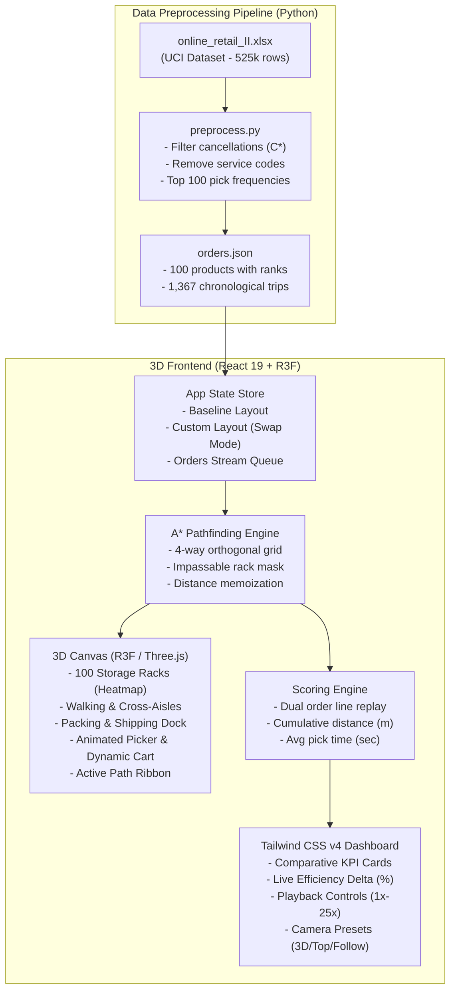

# NEXAI Warehouse Digital Twin
> **Hackathon Problem Statement 4.2**: Browser-Based 3D Digital Twin for Warehouse Picking Optimization & Layout Simulation

[](https://react.dev/)
[](https://threejs.org/)
[](https://docs.pmnd.rs/react-three-fiber/)
[](https://tailwindcss.com/)
[](https://python.org/)
[](https://pandas.pydata.org/)
[](https://creativecommons.org/licenses/by/4.0/)

---

## Live Deployment
- **Live Demo URL**: [https://nexai-warehouse-twin.vercel.app](https://nexai-warehouse-twin.vercel.app) *(Replace with your deployed production URL)*

---

## 1. Problem Statement & Solution Overview

### The Challenge (Problem Statement 4.2)
In modern order-fulfillment centers, picker travel time accounts for over **50% to 70% of total warehouse operating labor**. Suboptimal item slotting forces pickers to traverse excessive aisle distances to retrieve high-demand products.

The challenge is to construct an interactive, browser-based **3D Warehouse Digital Twin** that:
1. Ingests and cleans real transactional data from the **Online Retail II** dataset.
2. Identifies the top ~100 fastest-moving SKUs and isolates chronological order sequences.
3. Renders a functional 3D warehouse picking floor featuring storage racks, walking aisles, a packing dock, and an animated picker.
4. Solves picker routing using a strict **A* (A-Star) grid pathfinding algorithm** that prevents rack clipping and adheres strictly to designated aisles.
5. Implements a dual scoring engine comparing an **Optimal Baseline Layout** (fast movers slotted nearest to the dock) against a **Player Custom Layout** (interactive slot swapping) to quantify travel distance and pick time savings.

### Our Solution
**NEXAI Warehouse Digital Twin** provides an end-to-end simulation platform:
- **Rust/Python Data Pipeline**: Preprocesses 525k+ records in seconds, cleans cancellations and service codes, calculates SKU pick frequencies, and outputs a structured `orders.json` payload.
- **3D Digital Twin (React Three Fiber & Drei)**: An interactive 3D picking floor with 100 rack slots across 5 double-row bays, colored velocity heatmaps, a fully equipped packing dock, and a custom animated picker avatar and cart.
- **Strict A* Grid Navigation**: 4-way orthogonal grid routing ensuring the picker strictly navigates walkable aisles and cross-aisles, visualized by a live green floor ribbon.
- **Slotting Game Mode**: Enables users to interactively click-and-swap product locations or test layout presets (**Optimal**, **Randomized**, **Inverted**).
- **Dual Scoring Engine & Tailwind Dashboard**: Replays identical historical picking trips simultaneously across both layouts, presenting live counters for walking distance ($m$), average pick time ($s$), and percentage efficiency delta.

---

## 2. Architecture & Technology Stack

### System Architecture



### Technology Stack
- **3D Graphics & Canvas**: Three.js (0.186.x), `@react-three/fiber` (9.8.x), `@react-three/drei` (10.7.x)
- **Frontend Framework**: React 19, Vite 8.3
- **Styling & UI**: Tailwind CSS v4 (`@tailwindcss/vite`), CSS Grid, Lucide/Heroicon visual styling
- **Data Engineering**: Python 3.12+, Pandas 2.x, `python-calamine` (fast Rust-based Excel parser), OpenPyXL

---

## 3. Key Features

| Feature | Description |
| :--- | :--- |
| **Golden Zone Baseline** | Sorts all 100 rack slots by A* walking distance to the dock; automatically maps Rank 1 SKU nearest the dock, descending to Rank 100 furthest back. |
| **Player Custom Slotting** | Click any rack to select it, then click another rack to instantly swap product slots. Includes one-click presets (**Optimal**, **Randomize**, **Invert**). |
| **Strict A* Routing** | Guarantees zero diagonal shortcuts or obstacle clipping. Pickers only travel through designated aisles and cross-aisles. |
| **Dynamic Order Replay** | Replays real historical order lines. Picker moves along waypoints, pauses at racks to pick items, dynamically stacks cargo boxes onto the cart, and unloads at the packing dock. |
| **Live KPI Benchmarking** | Measures total walking distance ($m$) and average order pick time ($s$) side-by-side, displaying live percentage improvement/penalty badges. |
| **Batch Picking (TSP Brain)** | **Stretch Goal**: Groups sequential orders into batches (1, 3, or 5 orders) and calculates an optimal multi-stop tour using Nearest-Neighbor TSP over A* aisle paths, cutting monthly walking distance by up to 76%. |
| **Multi-Angle Camera** | Toggle between **3D Perspective**, **Top-Down (2D Plan)**, and **Follow Picker** tracking camera. |

---

## 4. Setup & Local Execution Instructions

### Prerequisites
- **Node.js**: v18.0.0 or higher (`npm` v9+)
- **Python**: v3.10, v3.11, or v3.12

### Step 1: Clone the Repository
```bash
git clone https://github.com/<your-username>/nexai-warehouse-twin.git
cd nexai-warehouse-twin
```

### Step 2: Run the Data Pipeline (Optional if orders.json is present)
The preprocessed `orders.json` is already bundled in `3d-frontend/public/orders.json`. To regenerate or reprocess from the raw Excel dataset:
```bash
# Install Python dependencies
pip install pandas python-calamine openpyxl

# Run preprocessing pipeline
python preprocess.py
```
*Outputs `orders.json` to project root and `3d-frontend/public/orders.json` in ~7 seconds.*

### Step 3: Run the 3D Frontend
```bash
cd 3d-frontend

# Install dependencies
npm install

# Start local development server
npm run dev
```

Open your browser at:
```
http://localhost:5173
```

### Step 4: Production Build
```bash
cd 3d-frontend
npm run build
npm run preview
```

---

## 5. Dataset Attribution & License

- **Dataset**: [Online Retail II Dataset](https://archive.ics.uci.edu/dataset/502/online+retail+ii)
- **Source**: UCI Machine Learning Repository
- **License**: Explicitly attributed under **Online Retail II, UCI CC BY 4.0** (Creative Commons Attribution 4.0 International).

---

## 6. Team Details & Development Log

- **Team Configuration**: Solo Member
- **Developer**: *NexAI Participant*
- **Development Log**: For detailed architectural decisions, trade-offs, AI collaboration logs, and rejected experiments, please read the [**DEV_LOG.md**](file:///c:/nexai-warehouse-twin/DEV_LOG.md).
